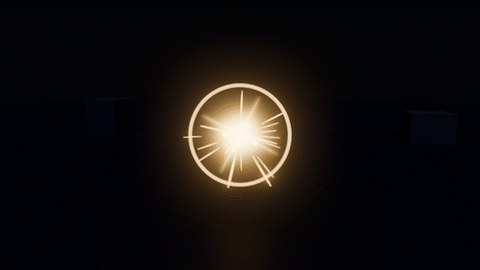
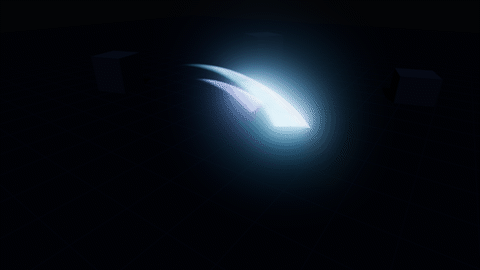
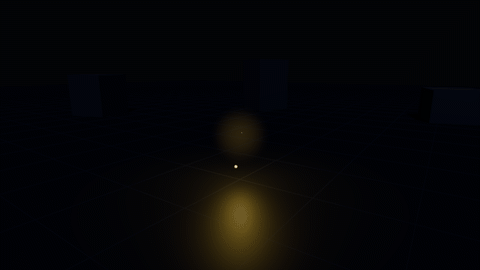

# REEBOO Stylized VFX - Free Sample for Godot 4

Three stylized visual effects for Godot 4, made from shaders and GPU particles: **Hit Spark**,
**Sword Slash** and **Pickup Sparkle**. There are no sprite sheets or baked textures apart from one
small noise texture, and every color, size and timing is a setting you can change in the Inspector.

Free to use in any project, commercial or not, under the [MIT license](LICENSE).

| Hit Spark | Slash | Pickup Sparkle |
|---|---|---|
|  |  |  |

**Requirements:** Godot 4.4 or newer (the full pack was tested on 4.4.1 and 4.7.2), Forward+ or
Mobile renderer.

## Install

- **From the Asset Library:** search for "REEBOO Stylized VFX Free Sample" in the AssetLib tab and
  install it. Only the `addons/reeboo_vfx` folder is added to your project.
- **From GitHub:** download or clone this repository and copy the `addons/reeboo_vfx` folder into
  your project's `addons/` folder.

No plugin needs to be enabled; the effects are plain scenes and a script.

## Quick start

Drag any scene from `addons/reeboo_vfx/effects/` into your level, or spawn one from code:

```gdscript
const HIT_SPARK := preload("res://addons/reeboo_vfx/effects/hit_spark.tscn")

func _on_enemy_hit(hit_position: Vector3) -> void:
	VFXEffect.spawn(HIT_SPARK, get_tree().current_scene, hit_position)
```

One-shot effects delete themselves when they finish. Looping effects keep running until you call
`stop()` or free them.

Turn on glow for the best look: add a `WorldEnvironment` with **Glow** enabled. The demo uses
intensity 0.7, HDR threshold 1.0, blend mode Screen and glow levels 2 to 5. The effects work
without glow, but glow is what makes them shine.

To see all three, open this project in Godot and press F5. Left/Right switches effect, Space
replays and A toggles auto-advance.

## The effects

| Scene | Type | Notes |
|---|---|---|
| `hit_spark` | one-shot | Melee or bullet impact |
| `slash` | one-shot | Sword swing in front of the node, along -Z |
| `pickup_sparkle` | looping | Coin or item glow |

Each effect uses fewer than 100 particles.

## VFXEffect (the root of every effect)

| Member | What it does |
|---|---|
| `VFXEffect.spawn(scene, parent, at, orientation)` | Static helper: instantiates a scene under `parent` at a world position |
| `play()` | Plays or replays every layer from the start |
| `stop()` | Stops emitting; live particles finish and lights fade out |
| `get_duration()` | Seconds until a one-shot effect is done |
| `is_looping()` | True for effects that run until stopped |
| `finished` (signal) | Emitted when a one-shot effect is done |
| `autoplay`, `auto_free`, `time_scale` | Inspector settings; `time_scale` speeds the whole effect up or down |
| **Replay** button | Previews the effect in the editor viewport |

Per-layer timing lives in node metadata, which you can edit in the Inspector: `vfx_delay`
(seconds before a layer or light starts), `vfx_flash` (seconds for a light to fade out) and
`vfx_flicker` (0 to 1, flicker for lights that stay on).

## Making it yours

- **Color:** select a layer, then *Process Material > Color > Color Ramp*.
- **Brightness:** *Material Override > Shader Parameters > Emission Energy*.
- **Size and count:** *Amount* on the layer; *Scale Min/Max* on its process material.
- **Shape:** the particle shader's *Shape* setting.
- **New effects:** duplicate a scene and change its ramps. All layers share the same shaders.

## Repository layout

- `addons/reeboo_vfx/`: the addon (effects, shaders, noise texture, `vfx_effect.gd`, license)
- `demo/`: a small showcase scene (not included in Asset Library downloads)
- `screenshots/`: the GIFs above

## Want more?

The full pack adds **22 more effects** (25 in total), with the same one-line spawn API:

explosion, fireball, fire impact, lightning strike, heal, level up, shield (with hit ripples),
portal, poison cloud, ice burst, muzzle flash, ground slam, campfire, burning, smoke poof,
water splash, arcane missile, collect burst, shadow burst, teleport, power aura and electric hit.

It costs $7 on itch.io: **https://reebo0.itch.io/stylized-vfx-godot**

The free sample page is at https://reebo0.itch.io/stylized-vfx-godot-free.

## How it was made

All visuals are procedural (rendered by the shaders and scripts), with no third-party art.

## License

MIT, copyright (c) 2026 REEBOO Labs. See [LICENSE](LICENSE). The 22 additional effects in the
paid pack are not part of this repository and are sold under a separate license.

Questions and requests are welcome in the GitHub issues.
